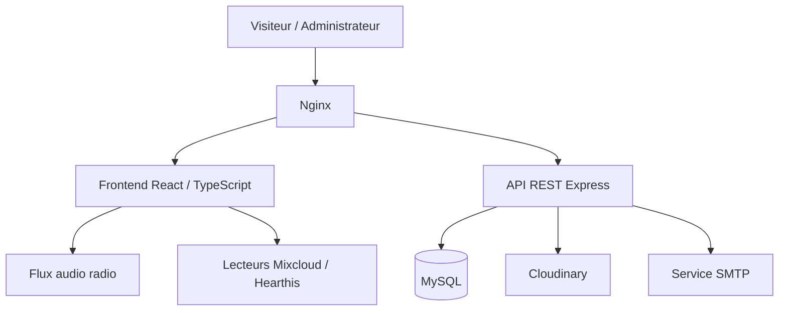

# Radio Face B

### Web radio musicale indépendante

Site officiel de **Radio Face B**, une radio en ligne indépendante proposant une programmation musicale et des mixtapes accessibles depuis ordinateur, tablette et mobile.

Ce projet personnel couvre l'ensemble du développement d'une application web : conception de l'interface, développement frontend et backend, gestion des données, intégration de services externes, sécurisation de l'API et déploiement avec Docker.

**Site en production :** [https://radiofaceb.org](https://radiofaceb.org)

---

## Présentation du projet

Radio Face B est une plateforme web conçue autour de l'identité musicale de la radio.

L'application propose une expérience d'écoute et de découverte musicale, avec un lecteur audio, une grille des programmes, un historique des titres diffusés et un catalogue de mixtapes.

Elle intègre également un espace d'administration permettant de gérer les contenus musicaux et les genres, ainsi que plusieurs fonctionnalités destinées aux visiteurs : newsletter et formulaire de contact.

Le développement comprend aussi la mise en place d'une Progressive Web App (PWA), d'une API REST et d'une infrastructure basée sur Docker et Nginx.

## Fonctionnalités

### Espace public

- **Écoute en direct** : lecteur audio intégré pour accéder au flux de la radio.
- **Lecture persistante** : gestion centralisée de l'état audio lors de la navigation.
- **Mixtapes** : catalogue de mixtapes organisé par genres musicaux.
- **Lecteurs externes** : intégration des plateformes Mixcloud et Hearthis.
- **Grille des programmes** : consultation de la programmation de la radio.
- **Historique musical** : consultation des titres diffusés.
- **Pages éditoriales** : présentation de la radio et informations pratiques pour l'écoute.
- **Newsletter** : formulaire d'inscription avec validation du consentement.
- **Contact** : formulaire de contact avec validation des données.
- **Responsive design** : interface adaptée aux différents formats d'écran.
- **PWA** : application web progressive pouvant être installée sur les appareils compatibles.

### Back-office d'administration

Un espace d'administration sécurisé permet de gérer les contenus de la plateforme.

- Tableau de bord avec statistiques.
- Création, modification et suppression des mixtapes.
- Gestion des genres musicaux.
- Gestion des informations et contenus associés aux mixtapes.
- Éditeur de contenu HTML basé sur Tiptap.
- Gestion des pochettes et des fichiers via Cloudinary.
- Authentification administrateur avec JWT.

## Stack technique

### Frontend

| Technologie | Utilisation |
|---|---|
| React 19 | Bibliothèque d'interface |
| TypeScript | Typage statique |
| Vite | Outil de développement et de build |
| Material UI | Composants d'interface |
| Sass | Styles |
| React Router | Navigation |
| React Hook Form | Gestion des formulaires |
| Zod | Validation des données |
| Tiptap | Éditeur de contenu |
| Vite PWA | Fonctionnalités PWA |

### Backend

| Technologie | Utilisation |
|---|---|
| Node.js 22 | Environnement serveur |
| Express 5 | API REST |
| MySQL 8 | Base de données |
| mysql2 | Connexion à MySQL |
| JWT | Authentification |
| bcrypt | Hachage des mots de passe |
| Zod | Validation des données |
| express-rate-limit | Limitation des requêtes |
| Multer | Gestion des fichiers téléversés |
| Cloudinary | Stockage et diffusion des médias |
| Nodemailer | Envoi des e-mails |

### Infrastructure et outils

- **Docker / Docker Compose** : conteneurisation des services.
- **Nginx** : reverse proxy et serveur de fichiers frontend.
- **Git / GitHub** : gestion du code source.
- **GitHub Actions** : intégration continue (CI).
- **ESLint** : analyse statique du code.
- **Prettier** : formatage du code.
- **Figma / Photoshop** : conception graphique et préparation des visuels.

## Architecture

L'application repose sur une architecture séparant le frontend, le backend et la base de données.



### Organisation du dépôt

```text
radioFaceB_project/
│
├── client/                 # Application React / TypeScript
│   ├── src/
│   │   ├── admin/          # Back-office
│   │   ├── components/     # Composants de l'interface
│   │   ├── context/        # Contextes et gestion d'état
│   │   ├── hooks/          # Hooks personnalisés
│   │   ├── pages/          # Pages publiques
│   │   ├── schemas/        # Schémas de validation
│   │   └── ...
│   └── Dockerfile
│
├── server/                 # API Node.js / Express
│   ├── db/                 # Connexion et scripts SQL
│   ├── scripts/            # Scripts d'administration
│   ├── src/
│   │   ├── controller/
│   │   ├── middleware/
│   │   ├── model/
│   │   ├── routes/
│   │   ├── validation/
│   │   └── utils/
│   └── Dockerfile
│
├── proxy/                  # Configuration Nginx
├── deploy/                 # Ressources de déploiement
├── .github/
│   └── workflows/          # GitHub Actions
│
└── docker-compose.example.yml
```

## Modèle de données

La base MySQL repose sur trois tables principales :

- **genre** : catégories musicales et couleurs associées.
- **mixtape** : informations des mixtapes, plateforme d'hébergement, présentation, tracklist, statut de publication et genre associé.
- **user** : comptes utilisateurs et rôles administrateurs.

Le dépôt comprend également :

- `schema.sql` : création de la structure de la base de données.
- `seed.sql` : insertion des neuf genres musicaux initiaux.

## Choix techniques et sécurité

Plusieurs aspects ont fait l'objet d'une attention particulière durant le développement.

### Organisation du code

- Séparation des responsabilités entre routes, contrôleurs, modèles, middlewares et validations côté backend.
- Séparation des espaces public et administrateur côté frontend.
- Centralisation de la gestion audio avec React Context.
- Réutilisation de composants et de hooks personnalisés.

### Sécurité de l'application

- Authentification administrateur basée sur JWT.
- Hachage des mots de passe avec bcrypt.
- Limitation des tentatives de connexion et des requêtes sensibles.
- Validation des données côté frontend et backend.
- Protection des formulaires publics contre les robots grâce à un champ honeypot.
- Vérification des données transmises lors des téléversements.
- Gestion des erreurs avec des réponses adaptées aux clients de l'API.

### Médias et services externes

- Cloudinary pour l'hébergement des médias.
- Intégration des lecteurs Mixcloud et Hearthis.
- Nodemailer pour le traitement des messages de contact et des inscriptions à la newsletter.

## Intégration continue

Le projet dispose d'un workflow GitHub Actions déclenché lors des pushes sur les branches `main` et `dev`, ainsi que lors des pull requests.

Deux jobs indépendants contrôlent le projet :

**Frontend**
- Installation des dépendances avec `npm ci`.
- Analyse ESLint.
- Compilation TypeScript et build Vite.

**Backend**
- Installation des dépendances avec `npm ci`.
- Analyse ESLint.
- Vérification du formatage avec Prettier.
- Vérification du chargement de l'application Express.

Cette intégration continue permet de contrôler automatiquement la qualité du code et la compilation avant l'intégration des modifications.

## Installation et environnement de développement

### Prérequis

- Node.js 22.
- npm.
- MySQL 8 pour une installation locale sans Docker.
- Docker et Docker Compose pour le lancement conteneurisé.

### Configuration

Des fichiers d'exemple sont fournis pour les variables d'environnement :

- `client/.env.example`
- `server/.env.example`
- `docker-compose.example.yml`

Ils servent de modèles pour préparer la configuration locale. Les identifiants, clés API et secrets doivent être renseignés dans les fichiers d'environnement appropriés et ne doivent jamais être publiés dans le dépôt.

### Lancement avec Docker

Le dépôt contient un fichier `docker-compose.example.yml` permettant de construire et démarrer les services :

- Nginx : reverse proxy.
- Frontend : application React compilée et servie par Nginx.
- Backend : API Express.
- MySQL : base de données.

Après préparation des fichiers de configuration nécessaires, le démarrage s'effectue avec :

```bash
docker compose up --build
```

### Développement sans Docker

Le frontend et le backend disposent chacun de leur propre `package.json` et de leurs propres scripts de développement.

Frontend :

```bash
cd client
npm install
npm run dev
```

Backend :

```bash
cd server
npm install
npm run dev
```

Une base MySQL configurée et les variables d'environnement correspondantes sont nécessaires au fonctionnement des fonctionnalités dépendantes de l'API.

## Aperçu de l'application

### Accueil


### Lecteur étendu


### Derniers titres diffusés


### Grille des programmes


### Mixtapes


### Pages et contenus


---

## Auteur

**Julien Bonet**  
Développement web Full Stack JavaScript

Site professionnel : [julienbonet.fr](https://julienbonet.fr)

---

*Radio Face B — Projet personnel de conception et de développement web full stack.*